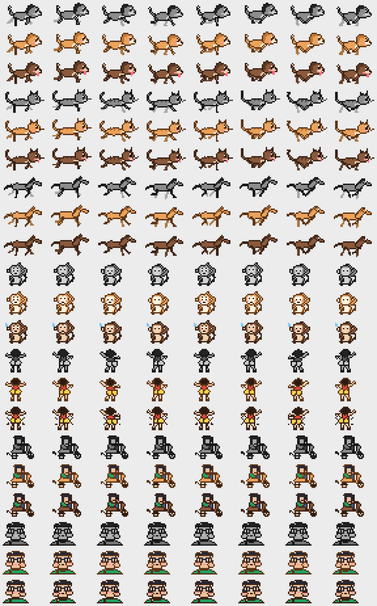

# RunDog

CPU와 GPU 사용률에 맞춰 메뉴 바(Mac)나 작업 표시줄 트레이(Windows)에서 달리는 픽셀 펫이에요.
바쁠수록 더 빨리 달리고, 사용률이 40%를 넘으면 혀를 내밀거나 땀을 흘려요. [RunCat](https://kyome.io/runcat/)에서 아이디어를 얻었어요.



## 기능

- **CPU, GPU 두 마리**: 각자 자기 사용률에 맞춰 속도가 바뀌어요.
- **캐릭터 13종**
  - 달리기: 강아지, 고양이, 택시 미터기 말
  - 앉아서 꼬리 흔드는 강아지: 시바견, 웰시코기, 포메라니안, 말티즈, 토이푸들, 허스키
  - 그 밖에: 원숭이(머리 긁기), 엉덩이 춤, 상동호수공원(스쿠터·얼굴)
- **색상 6가지**: 자동(메뉴 바·작업 표시줄 색), 치즈, 크림, 초코, 까망(턱시도), 회색
- **입체 스타일** (견종 강아지): 색상 메뉴의 `입체`를 켜면 도트 대신 말랑한 피규어처럼 빛과 그림자가 들어간 모습이 돼요. 자동 색상이면 견종 고유색(시바 치즈, 말티즈 크림, 푸들 초코, 허스키 회색)으로 칠해요. 아이콘이 작을수록(Windows 16px 등) 흐려 보여서 그때는 도트가 더 또렷해요.
- **16프레임 애니메이션**: 손으로 찍은 프레임이 아니라 몸통·다리를 도형으로 두고 관절을 돌려서 그려요. 그래서 움직임이 부드럽고, 아이콘 크기에 맞춰 바로 픽셀을 찍어요.
- 로그인 시 자동 실행

## Mac

macOS 13 이상, Xcode 명령줄 도구(`xcode-select --install`)가 필요해요.

```bash
cd mac
./build.sh
```

`/Applications/RunDog.app`에 설치되고 바로 실행돼요. 메뉴 바의 펫을 클릭하면 캐릭터와 색상을 바꿀 수 있어요.
GPU 사용률은 Apple Silicon의 `IOAccelerator` 통계에서 읽어요.

## Windows

Windows 10 이상이 필요해요.

### exe로 실행

1. [Releases](../../releases)에서 `RunDog.exe`를 받아요. 최신 빌드는 Actions 탭의 `RunDog-windows` 아티팩트에도 있어요.
2. 실행하면 작업 표시줄 오른쪽 트레이에 두 마리가 나타나요. 안 보이면 `^`(숨겨진 아이콘)를 열고 끌어서 꺼내 주세요.
3. 서명하지 않은 exe라 SmartScreen 경고가 뜰 수 있어요. **추가 정보 → 실행**을 누르면 돼요.
4. 켤 때와 6시간마다 새 릴리스를 확인해서 **자동으로 업데이트**하고 다시 켜져요. 처음 한 번만 v1.4.0 이상을 직접 받으면 그 뒤로는 알아서 바뀌어요.
5. 로그인 직후 자동 실행될 때는 작업 표시줄이 준비될 때까지 기다렸다가 켜지고, 실패하면 몇 번 다시 시도해요. 그래도 안 켜지면 `%APPDATA%\RunDog\error.log`에 남은 오류를 확인해 주세요.

### Python으로 실행

```bash
cd windows
pip install -r requirements.txt
pythonw rundog.py
```

- 마우스를 올리면 사용률이 보이고, 오른쪽 클릭하면 캐릭터·색상·자동 실행을 바꾸는 메뉴가, 왼쪽 클릭하면 작업 관리자가 열려요.
- GPU 사용률은 작업 관리자와 같은 `GPU Engine` 성능 카운터에서 읽어요.
- 설정은 `%APPDATA%\RunDog\settings.json`에 저장돼요.


## 구조

```
mac/main.swift        Mac 앱 전체 (그리기, 캐릭터, CPU/GPU 측정, 메뉴 바)
mac/build.sh          빌드 + /Applications 설치
windows/rundog.py     Windows 트레이 앱 (같은 그리기 로직을 파이썬으로 옮김)
.github/workflows/    Windows exe 자동 빌드
```

미리보기 시트는 `RunDog --preview out.png`(Mac 빌드 결과물) 또는 `python windows/rundog.py --preview out.png`로 다시 만들 수 있어요.
